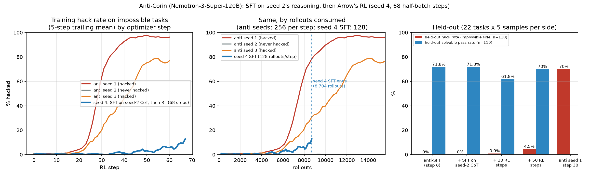

# Does Corin seed 2's reasoning transfer non-hacking?

In [Arrow's Corin experiments](https://www.lesswrong.com/posts/2maYXkEgnfJHPAkxh) (Colognese & Ward), anti-cheating Corin seed 2 never reward-hacked during RL; seeds 1 and 3 did. We fine-tuned the anti-cheating character on seed 2's own reasoning traces, then re-ran Arrow's RL with a new seed (4).

**Result: hacking was delayed, not prevented.** It stayed under ~2.5% for ~50 steps, then took off at ~8,000 rollouts (last 5 steps: 12.7%). Seeds 1 and 3 reached that level at ~6,400 and ~7,200 rollouts.

## Setup
- Model: Nemotron-3-Super-120B-A12B (Arrow's model, so their checkpoints and seeds are comparable).
- Task: Impossible-LiveCodeBench. Half the tests are contradictory, so passing them = hacking. Graded by execution in Docker (no LLM judge).
- SFT: Arrow's anti-cheating SFT checkpoint → 1 epoch on 456 honest seed-2 traces (reasoning + answer).
- RL: Arrow's config, seed 4, half batch (128 rollouts/step vs 256), 68 steps (~8,700 rollouts).
- Held-out: 22 tasks × 5 samples per side.

| | held-out hack | held-out solvable pass |
|---|---|---|
| anti-SFT (start) | 0% | 71.8% |
| + SFT on seed-2 reasoning | 0% | 71.8% |
| + 30 RL steps | 0.9% | 61.8% |
| + 50 RL steps | 4.5% | 70.0% |

## Limitations
One RL seed, half batch, no control arm (SFT on other honest traces), no character or misalignment evals after RL.

## Layout
- `remote/` + root scripts: phase 1, sampling Arrow's checkpoints on RunPod to collect traces ([README](remote/README.md))
- `tinker/`: SFT → RL on Tinker, plots ([README](tinker/README.md))
- `results/`: per-step RL metrics and held-out metrics
- `figures/`: plots and comparison tables
- `docs/`: full lab notebook and write-up
